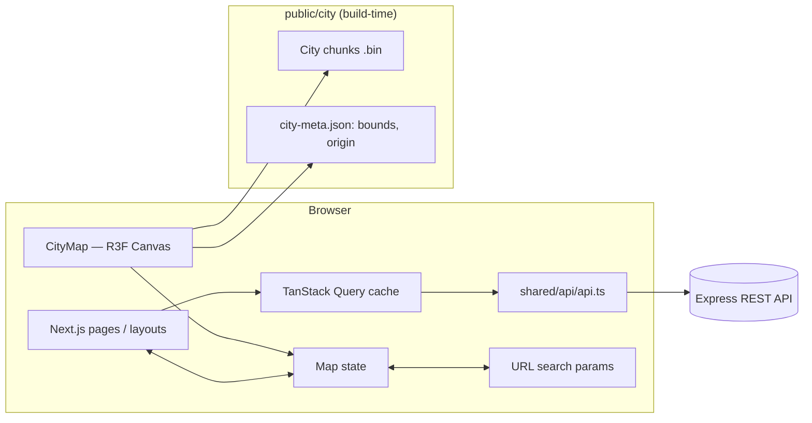
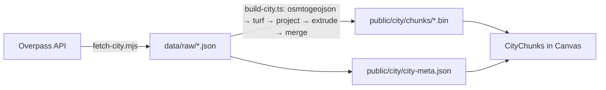

# Frontend System Design — Volunteer Quests of Dnipro

> ByteEater Hackathon · October 16–17, 2026
> Source: PRD "Volunteer Quests of Dnipro" (MVP + Optional)
> Scope: the Next.js frontend. The backend (Express, owned by another team) is described only as the contract the frontend expects.

---

## 1. Goals and constraints

**Frontend goal:** let a volunteer find a quest on a 3D map of Dnipro, sign up, complete it and see their progress (XP, level, reward). Let an organization create a quest and confirm its completion.

**Success criterion (Live Demo):**
sign in → quest on the map → join → complete → confirmation by the organization → XP and new level → exchange points for a promo code.

**Constraints:**
- ~24 hours of development, team of 2 frontend developers. Demo on a laptop / projector, plus a check on mobile.
- The 3D map is written from scratch in this Next.js project using `three` + `@react-three/fiber` + `@react-three/drei`, with city data from OpenStreetMap.
- Seed data: 8–10 quests, 2 organizations, 5 rewards. The map must run smoothly at this volume; scaling to thousands of quests is not a goal.
- All UI copy is in Ukrainian. Code, identifiers and comments are in English.

---

## 2. Tech stack

| Layer | Technology | Why |
|---|---|---|
| Framework | Next.js (App Router), React 19, TypeScript | Routing, role-based layouts, middleware |
| Styling / UI | Tailwind CSS (+ shadcn/ui after the prototype) | Fast mobile-first UI; Sheet, Dialog, Toggle components |
| 3D map | `three`, `@react-three/fiber`, `@react-three/drei`, `camera-controls` | City rendering, markers, camera |
| Geo data | `@turf/turf`, `osmtogeojson` (build scripts only) | Preparing city chunks |
| Server state | TanStack Query (after the prototype) | Caching quests, profile, rewards; invalidation after mutations |
| Client state | `useState` in the prototype → Zustand later | Map state: filter, selected quest, camera target |
| Forms | React Hook Form + zod | Registration, quest creation |
| Auth | JWT in an httpOnly cookie, role check via `jose` in middleware | Protecting `/org` |
| Animation | CSS transitions + `camera-controls` | Fly-to, panel, level-up |

`@turf/turf` and `osmtogeojson` never reach the client bundle: they are used only by the data-preparation scripts.

---

## 3. Architecture



**Principles:**
1. **The city is static, quests are dynamic.** Dnipro's geometry is generated ahead of time by scripts and lives in `public/city`. Only quests (with `lat/lng`) come from the API and are drawn on top.
2. **One source of truth for the projection.** The `lat/lng → x/z` conversion is a single function shared by the build scripts and the runtime (§6.2).
3. **One file for all backend calls.** Every request goes through `src/shared/api/api.ts` (§9). Components never call `fetch` directly.
4. **The URL reflects map state.** The selected quest and the category filter live in query params: the page can be reloaded or shared, and the browser Back button closes the panel.
5. **Server state ≠ UI state.** API data lives in TanStack Query; the map store holds only pure UI state.

---

## 4. Building the 3D map of Dnipro from scratch

The map has two independent parts:

1. **Build-time pipeline** (Node scripts): downloads Dnipro from OpenStreetMap, turns it into ready-made 3D geometry and writes binary files to `public/city`. Runs once; the output is committed to the repo.
2. **Runtime** (browser): the Next.js page loads the prebuilt geometry, renders the city and draws quest markers from the API on top.

The browser never does heavy geoprocessing; it only reads prepared buffers.



### 4.1 Dependencies

```bash
# runtime
npm i three @react-three/fiber @react-three/drei camera-controls zustand @tanstack/react-query
# scripts only
npm i -D @types/three tsx osmtogeojson @turf/turf
```

`@turf/turf` and `osmtogeojson` go to `devDependencies`. `camera-controls` is installed explicitly because we import its `ACTION` constants (§6.3).

```json
"scripts": {
  "city:fetch": "node scripts/fetch-city.mjs",
  "city:build": "node --max-old-space-size=8192 --import tsx scripts/build-city.ts"
}
```

### 4.2 Step 1 — fetching OSM data (`scripts/fetch-city.mjs`)

- **Bounds:** Dnipro bbox (approx. `48.36, 34.85, 48.58, 35.25` — south, west, north, east). Stored in `scripts/city.config.ts` together with `ORIGIN`.
- **Layers and Overpass queries:**

| Layer | OSM tags |
|---|---|
| Buildings | `building=*` (+ `height`, `building:levels`) |
| Water | `natural=water`, `waterway=riverbank`, `water=river` |
| Green areas | `leisure=park`, `landuse=grass|forest|recreation_ground`, `natural=wood` |
| Roads | `highway=motorway|trunk|primary|secondary|tertiary|residential` |
| Bridges (opt.) | `bridge=yes` |

- Dnipro has many buildings, so the query is **split into a grid** over the bbox (e.g. 4×4), otherwise Overpass times out.
- Pause 2–5 s between requests and retry on failure; the public Overpass instance is rate-limited.
- Output: `data/raw/{layer}-{tile}.json`. **Raw data is committed** so the team does not depend on Overpass during the hackathon.

### 4.3 Step 2 — building geometry (`scripts/build-city.ts`)

For each layer:

1. **`osmtogeojson`** → GeoJSON `FeatureCollection`.
2. **Cleanup with turf:**
   - keep only `Polygon` / `MultiPolygon` (`LineString` for roads);
   - `turf.simplify` (tolerance ~0.00001°) to reduce vertices;
   - drop buildings smaller than 30 m² (`turf.area`) — invisible from above but costly in triangles;
   - clip to the city bbox (`turf.bboxClip`).
3. **Building height:** `height` → `building:levels × 3 m` → default 9 m.
4. **Projection:** every vertex `lat/lng → x/z` via `src/features/map/lib/projection.ts` (the same file the client uses).
5. **Chunking:** ~2×2 km grid; a feature goes into the chunk containing its centroid (`turf.centroid`).
6. **Geometry with `three` in Node:**
   - buildings → `Shape` + `ExtrudeGeometry({ depth: h, bevelEnabled: false })`, rotated into the XZ plane;
   - water, parks → flat `ShapeGeometry`;
   - roads → coordinates for `LineSegments` (simplest and cheap; looks clean from above). Upgrade path: major roads as `turf.buffer` polygons with width by road class;
   - all geometries of one layer in one chunk are merged with `mergeGeometries` from `three/examples/jsm/utils/BufferGeometryUtils.js`.
7. **Output:** `public/city/chunks/{chunkId}.{layer}.bin` — `positions: Float32Array`, `normals: Float32Array`, `indices: Uint32Array` back to back; array lengths go into `city-meta.json`.
8. **`city-meta.json`:**

```json
{
  "origin": { "lat": 48.4647, "lng": 35.0462 },
  "bounds": { "minX": -14000, "maxX": 15000, "minZ": -12000, "maxZ": 12000 },
  "chunks": [
    { "id": "3_2", "bbox": [-2000, -4000, 0, -2000],
      "layers": { "buildings": { "pos": 482112, "idx": 240960 }, "water": { "pos": 1200, "idx": 600 } } }
  ]
}
```

**Budget:** `public/city` should stay under ~20 MB in total. If it is larger: stronger `simplify`, a higher building-area threshold, only major road classes.

**To avoid running out of memory:** process layer by layer and chunk by chunk, writing each file immediately instead of holding the whole city in one array.

### 4.4 Step 3 — rendering the city (runtime)

```tsx
// src/features/map/scene/CityChunks.tsx (simplified)
'use client';
import { BufferAttribute, BufferGeometry } from 'three';

async function loadLayer(chunkId: string, layer: string, sizes: { pos: number; idx: number }) {
  const buf = await fetch(`/city/chunks/${chunkId}.${layer}.bin`).then((r) => r.arrayBuffer());
  const pos = new Float32Array(buf, 0, sizes.pos);
  const nor = new Float32Array(buf, sizes.pos * 4, sizes.pos);
  const idx = new Uint32Array(buf, sizes.pos * 8, sizes.idx);
  const g = new BufferGeometry();
  g.setAttribute('position', new BufferAttribute(pos, 3));
  g.setAttribute('normal', new BufferAttribute(nor, 3));
  g.setIndex(new BufferAttribute(idx, 1));
  g.computeBoundingSphere();
  return g;
}
```

- **Materials:** one shared material per layer (`MeshStandardMaterial` for buildings, `MeshBasicMaterial` for flat layers), never one per mesh.
- **Flat layer order:** `ground y=0` → `water y=0.2` → `parks y=0.4` → `roads y=0.6`, plus `polygonOffset`, to avoid z-fighting.
- **Ground:** a large plane under the city. It also catches clicks: closing the panel (§6.1) or picking a quest location in organization mode (§7).
- **Lighting:** `ambientLight` + an angled `directionalLight`, so roofs and walls get different tones even from above.
- **Loading:** `city-meta.json` and central chunks first, the rest afterwards; `MapSkeleton` until done.
- **Attribution:** `© OpenStreetMap contributors` must be visible in a map corner (ODbL license requirement).

### 4.5 Step 4 — interactivity
Camera (§6.3) → quest markers (§6.4) → filter and panel (§6.5–6.6) → location picking for organizations (§7).

### 4.6 Risks and plan B

| Risk | Mitigation |
|---|---|
| Overpass unavailable / rate-limited | bbox tiles, retries; raw data committed after the first successful run |
| Script runs out of memory | Process per layer and per chunk, `--max-old-space-size=8192` |
| Map is slow on the demo laptop | Stronger `simplify`, fewer buildings, `frameloop="demand"`, `dpr={[1, 1.5]}` |
| Pipeline not ready by the evening | **Plan B:** the `CityGround` placeholder plane (optionally textured with a static OSM-based image of Dnipro, with attribution) + the same markers, camera and panel. All interactivity stays; only the background changes |

The prototype (§12) already ships with the plan B placeholder, so the rest of the product (markers, filter, panel, join) never waits for the city pipeline.

### 4.7 Rules for R3F in Next.js

- Every file that touches the scene has `'use client'`.
- `<Canvas>` is loaded through `next/dynamic` with `ssr: false`, because WebGL does not exist on the server:

```tsx
'use client';
import dynamic from 'next/dynamic';

const CityMap = dynamic(() => import('@/features/map/CityMap').then((m) => m.CityMap), {
  ssr: false,
  loading: () => <div className="h-dvh w-full animate-pulse bg-slate-200" />,
});
```

- Chunks are loaded with `fetch('/city/chunks/…')`, never imported into the bundle.
- Generated `public/city` files are **committed** so deployment does not rebuild the city.

---

## 5. Routing and pages

```
src/app/
├── (auth)/
│   ├── login/page.tsx
│   └── register/page.tsx            # role choice + role-specific form
├── (volunteer)/
│   ├── layout.tsx                   # header + bottom navigation (mobile)
│   ├── map/page.tsx                 # ★ main page: 3D map + filter + quest panel
│   ├── quests/page.tsx              # dispatcher columns by status
│   ├── rewards/page.tsx             # reward catalog
│   └── profile/page.tsx             # XP, level, frame, badges, promo codes
├── org/
│   ├── layout.tsx                   # organization dashboard sidebar
│   ├── page.tsx                     # my quests
│   ├── quests/new/page.tsx          # create a quest + pick a location on the map
│   └── quests/[id]/page.tsx         # participants, completion confirmation
├── layout.tsx                       # Providers: QueryClient, Toaster
└── page.tsx                         # redirect by role: /map or /org
```

Route groups in parentheses do not appear in the URL: the map page is `/map`.

**Route protection** — `middleware.ts` (named `proxy.ts` in newer Next.js versions):
- no token on `/map`, `/quests`, `/rewards`, `/profile`, `/org/*` → `/login`;
- role `volunteer` on `/org/*` → `/map`;
- role `organization` on volunteer pages → `/org`.

Middleware only hides pages. The real role and ownership checks happen in Express.

---

## 6. Map page `/map` — detailed design

### 6.1 UX specification

**Layout (desktop):**

```
┌──────────────────────────────────────────────────────────────┐
│  [All] [🐾 Animals] [🌳 Ecology] [📦 Logistics] [👵 Elderly] … │  ← category filter (fixed top)
├──────────────────────────────────────────┬───────────────────┤
│                                          │  QuestPanel       │
│      3D map of Dnipro (top-down view)    │  (opens on        │
│              ●        ●                  │   marker click)   │
│        ●           ◉ ← selected          │                   │
│                 ●                        │  [Join]           │
└──────────────────────────────────────────┴───────────────────┘
```

**Mobile:** the filter is a horizontally scrollable row of chips at the top; the panel is a bottom sheet covering ~60% of the screen height.

**Camera behavior:**

| Action | Behavior |
|---|---|
| Initial state | The whole city is in view, the camera looks straight down |
| Rotation | **Disabled** (mouse and touch) |
| Drag (left mouse / one finger) | Pan across the map plane (screen X/Y = world X/Z) |
| Wheel / pinch | Zoom only within a small range (`minDistance … maxDistance`) |
| Bounds | The camera cannot leave the Dnipro bbox |
| Marker click | Smooth fly-to the marker (~0.8 s); the panel opens on the right |
| Panel closed | The panel hides; the camera stays where it is (no jump back) |
| Click on empty map | Closes the panel (a drag must not count as a click) |
| `Esc` / browser Back | Closes the panel |

**Category filter:**
- Multi-select: clicking an icon toggles that category; "All" resets the filter.
- With nothing selected, all markers are shown.
- If the selected quest is hidden by the filter, the panel closes.
- Each chip shows a quest count (`🐾 3`).

**Markers:**
- The icon shows the category; the ring color shows the quest status for the current user:
  `available` (blue) · `joined` (yellow) · `completed` (green) · `full` (grey).
- Markers always face the camera and keep a constant on-screen size regardless of zoom.
- Hover: slight scale-up + tooltip with the title.
- Several quests at one point → one marker with a count badge; clicking it lists those quests in the panel.

**Quest panel (`QuestPanel`):**
- Title, category, organization (logo, name), description, address, date and time, duration, XP, free slots (`3 / 5`).
- The action button depends on state:
  - `Join` («Записатися») → optimistic update, toast;
  - `Joined · Cancel` («Ви записані · Скасувати»);
  - `Mark as done` («Позначити виконаним», on the quest day) → photo upload / check-in;
  - `Awaiting confirmation` («Очікує підтвердження»);
  - `Completed +50 XP` («Виконано +50 XP»);
  - `No slots left` («Місць немає», disabled).
- For an unauthenticated user the button leads to `/login?next=/map?quest=…`.

### 6.2 Coordinate system, projection, map constants

Three.js: the map lies in the **XZ** plane, **Y** points up. The camera hangs above the city and looks down along −Y.

```ts
// src/features/map/lib/projection.ts
// Single source of the projection: imported by both scripts/build-city.ts and the client.
export const ORIGIN = { lat: 48.4647, lng: 35.0462 }; // Dnipro center; same constant as scripts/city.config.ts
export const BBOX = { south: 48.36, west: 34.85, north: 48.58, east: 35.25 };

const M_PER_DEG_LAT = 110_540;
const M_PER_DEG_LNG = 111_320 * Math.cos((ORIGIN.lat * Math.PI) / 180);

/** 1 scene unit = 1 meter */
export function project(lat: number, lng: number): [x: number, z: number] {
  return [(lng - ORIGIN.lng) * M_PER_DEG_LNG, -(lat - ORIGIN.lat) * M_PER_DEG_LAT];
}

export function unproject(x: number, z: number): { lat: number; lng: number } {
  return { lat: ORIGIN.lat - z / M_PER_DEG_LAT, lng: ORIGIN.lng + x / M_PER_DEG_LNG };
}

const [minX, maxZ] = project(BBOX.south, BBOX.west);
const [maxX, minZ] = project(BBOX.north, BBOX.east);
export const CITY_BOUNDS = { minX, maxX, minZ, maxZ };

const FOV = 45;
const cityHeight = maxZ - minZ;
const fitDistance = cityHeight / 2 / Math.tan(((FOV / 2) * Math.PI) / 180);

// Tune by hand once the real city is rendered.
export const CAMERA = {
  FOV,
  POLAR: 0,                          // 0 = straight down; ~0.3 rad gives a slight 3D tilt
  MAX_DISTANCE: fitDistance * 1.05,  // the whole city fits in view
  MIN_DISTANCE: fitDistance * 0.55,  // "only a little deeper"
};
```

`unproject` is used for location picking by organizations (map click → `lat/lng`).

> The city build script and the quest markers must both use this exact function. A second copy of the formula would make markers drift off the streets. A local equirectangular projection around the city center has meter-level error at Dnipro's scale, which is enough for this map.

### 6.3 Camera: `CameraControls` from drei

`CameraControls` (a wrapper around `camera-controls`) is used instead of `MapControls` because it supports animated `setLookAt` for fly-to, movement boundaries (`setBoundary`) and flexible gesture remapping out of the box.

```tsx
// inside src/features/map/CityMap.tsx
import { CameraControls } from '@react-three/drei';
import CameraControlsImpl from 'camera-controls';
import { useEffect, useRef } from 'react';
import { Box3, Vector3 } from 'three';
import { CAMERA, CITY_BOUNDS } from './lib/projection';

const { ACTION } = CameraControlsImpl;

function MapCamera({ focus }: { focus: [x: number, z: number] | null }) {
  const ref = useRef<CameraControls>(null);

  useEffect(() => {
    const c = ref.current;
    if (!c) return;

    // Top-down only: rotation fully disabled
    c.azimuthRotateSpeed = 0;
    c.polarRotateSpeed = 0;
    c.minPolarAngle = c.maxPolarAngle = CAMERA.POLAR;

    // Gestures: drag = pan, wheel/pinch = limited zoom
    c.mouseButtons.left = ACTION.TRUCK;
    c.mouseButtons.right = ACTION.TRUCK;
    c.mouseButtons.wheel = ACTION.DOLLY;
    c.touches.one = ACTION.TOUCH_TRUCK;
    c.touches.two = ACTION.TOUCH_DOLLY;
    c.touches.three = ACTION.NONE;

    c.minDistance = CAMERA.MIN_DISTANCE;
    c.maxDistance = CAMERA.MAX_DISTANCE;

    c.setBoundary(new Box3(
      new Vector3(CITY_BOUNDS.minX, 0, CITY_BOUNDS.minZ),
      new Vector3(CITY_BOUNDS.maxX, 0, CITY_BOUNDS.maxZ),
    ));
    c.boundaryFriction = 0.2;

    c.setLookAt(0, CAMERA.MAX_DISTANCE, 0.001, 0, 0, 0, false);
  }, []);

  // Fly-to when a quest is selected
  useEffect(() => {
    const c = ref.current;
    if (!c || !focus) return;
    const [x, z] = focus;
    c.setLookAt(x, CAMERA.MIN_DISTANCE, z + 0.001, x, 0, z, true); // true = animated
  }, [focus]);

  return <CameraControls ref={ref} makeDefault smoothTime={0.35} />;
}
```

> The `z + 0.001` offset is needed because with the camera exactly above the target (`polar = 0`) the "up" direction degenerates and the camera can jitter.

### 6.4 Quest markers

```tsx
// inside src/features/map/CityMap.tsx
import { Html } from '@react-three/drei';

{quests.map((q) => {
  const [x, z] = project(q.lat, q.lng);
  return (
    <Html key={q.id} position={[x, MARKER_HEIGHT, z]} center zIndexRange={[10, 0]}>
      <button
        className={markerClass(q, q.id === selectedId)}
        onClick={(e) => { e.stopPropagation(); onSelect(q); }}
        aria-label={q.title}
      >
        {CATEGORIES[q.category].emoji}
      </button>
    </Html>
  );
})}
```

**Why `Html` and not sprites:** for ~10–50 markers, DOM buttons give a constant on-screen size, CSS hover, accessibility and clicks without raycasting. With 200+ markers, switch to `Instances` + an icon texture atlas.

**Grouping by location** (after the prototype): key = coordinates rounded to ~20 m; one marker per group with a count badge. This covers the PRD item "click on an icon → list of quests at that point".

**Clustering** (PRD: clusters when zoomed out): given the small fixed zoom range and ~10 seed quests, this is **phase 2** — a simple grid clustering in screen space when `distance > threshold`. It does not block the demo.

### 6.5 Map state

**Prototype:** plain `useState` in `map/page.tsx` — `quests`, `selectedCategories`, `selectedId`, `pending`.

**After the prototype:** move UI state to a Zustand store; quests move to TanStack Query.

```ts
// src/features/map/store/mapStore.ts
type MapState = {
  categories: Category[];                    // [] = all
  selectedGroupId: string | null;
  selectedQuestId: string | null;            // when a group has several quests
  flyTarget: [x: number, z: number] | null;

  toggleCategory: (c: Category) => void;
  resetCategories: () => void;
  selectGroup: (g: QuestGroup) => void;      // sets selection + flyTarget
  selectQuest: (id: string) => void;
  closePanel: () => void;                    // clears selection, does NOT move the camera
};
```

**URL sync** (`useMapUrlSync`): `/map?cat=animals,ecology&quest=q_123`
- on page load: read params, apply the filter, open the quest and fly to it;
- on store changes: `router.replace` for the filter, `router.push` for opening a quest (so Back closes the panel).

### 6.6 Page component tree

```
MapPage                                app/(volunteer)/map/page.tsx  ('use client')
├── CategoryFilterBar                  chips with counts (inline in the page in the prototype)
├── CityMap (dynamic, ssr:false)       features/map/CityMap.tsx
│   └── <Canvas frameloop="demand" dpr={[1, 2]}>
│       ├── MapCamera
│       ├── Lights
│       ├── CityGround                 prototype placeholder → replaced by CityChunks (§4.4)
│       └── Markers
├── QuestPanel                         features/map/ui/QuestPanel.tsx — right panel / bottom sheet
│   ├── QuestGroupList                 when a point has >1 quest (after the prototype)
│   └── action button                  join / cancel / mark done / status
└── MapLegend                          status colors (small badge in a corner, after the prototype)
```

### 6.7 Performance

- `frameloop="demand"` — frames render only while the camera moves or something changes; the demo laptop stays cool.
- `dpr={[1, 2]}` — caps pixel density on retina screens.
- City chunks: merged geometries (one mesh per chunk and layer), shared materials.
- Markers re-render only when the quest list or filter changes.
- First load: show a skeleton while chunks load; start with central chunks.

---

## 7. Other pages (brief)

### `/quests` — volunteer dispatcher view
Four columns (tabs on mobile): **Available · Joined · In progress · Completed**. A quest card links to `/map?quest=…`. "Mark as done" opens a dialog with photo upload / check-in.

### `/org/quests/new` — create a quest
Form (RHF + zod): title, description, category, date and time, duration, number of volunteers, XP.
**Location picking:** the same `CityMap` in `mode="pick"`: click on the ground → `event.point` → `unproject(x, z)` → `lat/lng` into the form; a temporary marker is shown.

### `/org/quests/[id]` — participants
List of joined volunteers with their status; "Confirm" / "Reject" buttons for `pending_review`.

### `/profile`
Avatar with a **level-based frame**, title, XP progress bar to the next level, points balance, badges, redeemed promo codes.

### `/rewards`
Partner reward catalog with prices in points; the button is disabled when points are insufficient («Бракує 40 балів»). After redemption, a dialog shows the promo code.

### Level-up
After a quest is confirmed, the backend returns `{ xpGained, levelBefore, levelAfter }`. If the level changed, a "New level!" modal shows the new frame. The volunteer sees it on the next profile request (15 s polling of `/me` during the demo, or a refetch on window focus).

---

## 8. Data models (frontend)

```ts
// src/shared/types.ts
export type Role = 'volunteer' | 'organization';

export type Category =
  | 'animals' | 'ecology' | 'elderly' | 'logistics' | 'donation' | 'city';

export type QuestStatus = 'open' | 'full' | 'finished' | 'cancelled';

export type ParticipationStatus =
  | 'joined' | 'in_progress' | 'pending_review' | 'completed' | 'rejected';

export interface Quest {
  id: string;
  title: string;
  description: string;
  category: Category;
  lat: number;
  lng: number;
  address: string;
  startsAt: string;            // ISO
  durationHours: number;
  slotsTotal: number;
  slotsTaken: number;
  xpReward: number;
  status: QuestStatus;
  organization: { id: string; name: string; logoUrl?: string };
  myParticipation: { status: ParticipationStatus } | null; // for the current user
}

export interface Badge {
  id: string;
  title: string;
  icon: string;
}

export interface Me {
  id: string;
  role: Role;
  name: string;
  avatarUrl?: string;
  // volunteer only
  xp?: number;
  points?: number;
  level?: number;
  nextLevelXp?: number;
  badges?: Badge[];
}

export interface Reward {
  id: string;
  partnerName: string;
  title: string;
  description: string;
  pricePoints: number;
}

export interface QuestGroup {   // frontend only, for the map
  id: string;
  x: number;
  z: number;
  category: Category;           // category of the first quest
  quests: Quest[];
}
```

```ts
// src/shared/categories.ts — the single category dictionary
export const CATEGORIES: Record<Category, { label: string; emoji: string; color: string }> = {
  animals:   { label: 'Тварини',   emoji: '🐾', color: '#F59E0B' },
  ecology:   { label: 'Екологія',  emoji: '🌳', color: '#22C55E' },
  elderly:   { label: 'Літні люди', emoji: '👵', color: '#A855F7' },
  logistics: { label: 'Логістика', emoji: '📦', color: '#3B82F6' },
  donation:  { label: 'Донорство', emoji: '🩸', color: '#EF4444' },
  city:      { label: 'Місто',     emoji: '🏙️', color: '#64748B' },
};
```

The marker status on the map is computed on the frontend from `status`, `slotsTaken/slotsTotal` and `myParticipation`.

---

## 9. API contract and `api.ts`

**All backend calls live in one file: `src/shared/api/api.ts`.**
- URLs, methods and request bodies exist only there.
- Components and hooks never call `fetch` directly; they call functions from `api.ts`.
- If the backend changes a path or an endpoint, only `api.ts` changes. If fields really change, update `shared/types.ts` and the places that use them by hand.
- A small `fetch` wrapper with `credentials: 'include'` and the base URL from `NEXT_PUBLIC_API_URL`.
- **While the backend is not ready**, the same functions return in-memory mocks with a short delay. Switching to the real API means replacing function bodies; callers do not change.

```ts
// src/shared/api/api.ts (shape)
const API_URL = process.env.NEXT_PUBLIC_API_URL;

async function http<T>(path: string, init?: RequestInit): Promise<T> {
  const res = await fetch(`${API_URL}${path}`, {
    credentials: 'include',
    headers: { 'Content-Type': 'application/json', ...init?.headers },
    ...init,
  });
  if (!res.ok) throw new Error(`${res.status} ${path}`);
  return res.status === 204 ? (undefined as T) : res.json();
}

// TODO: replace mock with: return http<Quest[]>('/quests');
export async function getQuests(): Promise<Quest[]> { /* mock */ }
```

Expected endpoints:

| Method | Path | Role | Purpose |
|---|---|---|---|
| POST | `/auth/register` | — | Register with a role |
| POST | `/auth/login` | — | Sets the httpOnly cookie |
| POST | `/auth/logout` | any | |
| GET | `/me` | any | Profile + XP / level |
| GET | `/quests?category=a,b` | any | Quests for the map (with `myParticipation`) |
| GET | `/quests/:id` | any | Details |
| POST | `/quests/:id/join` | volunteer | Join |
| DELETE | `/quests/:id/join` | volunteer | Cancel |
| POST | `/quests/:id/complete` | volunteer | Mark as done (photo / check-in) |
| GET | `/me/quests` | volunteer | Dispatcher columns |
| POST | `/org/quests` | organization | Create a quest |
| GET | `/org/quests` | organization | My quests |
| GET | `/org/quests/:id/participants` | organization | Participants |
| POST | `/org/quests/:id/participants/:userId/confirm` | organization | Confirm → XP awarded |
| GET | `/rewards` | volunteer | Catalog |
| POST | `/rewards/:id/redeem` | volunteer | Exchange points → promo code |

**Mutations and cache (TanStack Query, after the prototype):**
- `join` / `cancel` — optimistic updates of `['quests']` and `['quest', id]`; rollback + toast on error.
- `confirm` — invalidates `['org-quests', id]`.
- `redeem` — invalidates `['me']`, `['rewards']`.

Express must configure CORS with `credentials: true` and the exact frontend origin.

**Open questions for the backend team** (from the current DB diagram):
- no volunteer-to-quest participation table (`quest_id`, `volunteer_id`, `status`) — required for join → done → confirm and for marker status;
- `reward` references `quest.id` and `organization_name`, but rewards come from partners, not quest organizations;
- one `promocode` per reward; each redemption needs its own code (a redemptions table);
- `user` has no `email` / `password_hash` for login.

---

## 10. Project structure

```
/
├── docs/frontend-system-design.md
├── scripts/                       fetch-city.mjs, build-city.ts, city.config.ts
├── data/raw/                      raw Overpass responses (committed)
├── public/city/                   chunks/*.bin, city-meta.json, icons/*
└── src/
    ├── app/                       routing (§5)
    ├── features/
    │   ├── map/
    │   │   ├── CityMap.tsx        Canvas, camera, markers
    │   │   ├── scene/             CityGround (placeholder) → CityChunks, Lights
    │   │   ├── ui/                QuestPanel, CategoryFilterBar, MapLegend
    │   │   ├── store/mapStore.ts  (after the prototype)
    │   │   └── lib/               projection.ts, grouping.ts
    │   ├── quests/                hooks (useQuests, useJoinQuest…), QuestCard, QuestActionButton
    │   ├── org/                   CreateQuestForm, ParticipantsTable
    │   ├── profile/               LevelFrame, XpProgress, BadgesList
    │   ├── rewards/               RewardCard, RedeemDialog
    │   └── auth/                  LoginForm, RegisterForm, RoleSelect
    ├── shared/
    │   ├── api/api.ts             all backend calls (mocks until the backend is ready)
    │   ├── ui/                    shared UI components
    │   ├── categories.ts          icon, color and label for each category
    │   └── types.ts
    └── middleware.ts
```

`shared/categories.ts` is the single category dictionary used by the filter, markers, quest form and cards.

---

## 11. Demo reliability

- **Seed data** tied to real places in Dnipro (animal shelter, park, humanitarian aid warehouse), so markers sit on recognizable locations.
- **Test accounts:** 1 volunteer just below a level threshold (so confirming one quest triggers a level-up during the demo) + 2 organizations.
- **Two windows during the demo:** volunteer and organization in different browsers / incognito, to show confirmation live.
- **Map fallback:** if WebGL is unavailable or chunks fail to load, show the quest list (same cards / panel); the page never breaks.
- Error boundary around `CityMap`; toasts on mutation errors.

---

## 12. Delivery plan and team split

### Phase 0 — prototype (both developers, ~2 h)
A minimal `/map` page that proves the core interaction with mocks:

| File | Purpose |
|---|---|
| `src/shared/types.ts` | Domain types (§8) |
| `src/shared/categories.ts` | Category dictionary |
| `src/shared/api/api.ts` | `getQuests`, `joinQuest`, `leaveQuest` returning mocks |
| `src/features/map/lib/projection.ts` | Projection, bounds, camera constants (§6.2) |
| `src/features/map/scene/CityGround.tsx` | Placeholder city plane (plan B) |
| `src/features/map/CityMap.tsx` | Canvas, camera, markers |
| `src/features/map/ui/QuestPanel.tsx` | Quest details + join/cancel |
| `src/app/(volunteer)/map/page.tsx` | State, filter bar, layout |

No auth, no backend, no Zustand, no TanStack Query — `useState` only.

### Phase 1 — parallel work

File ownership keeps the two developers out of each other's way. `shared/types.ts` is the only shared file; agree on changes to it verbally.

| Developer A — City | Developer B — Product |
|---|---|
| `scripts/*`, `data/raw`, `public/city` | `shared/api/api.ts`: mocks → real backend |
| `CityChunks` replacing `CityGround` | Auth pages + middleware |
| Camera tuning in `projection.ts` | `QuestPanel` states, filter bar, toasts |
| Organization location picking (`mode="pick"`) | Org dashboard: create quest, confirm participants |
| Marker grouping / clustering | Profile, level-up, rewards and redemption |
| Map performance and fallback | Zustand + TanStack Query, URL sync |

### Priorities

| # | Task | Owner | Blocks the demo |
|---|---|---|---|
| 0 | Prototype `/map` with mocks and placeholder ground | A + B | ✅ |
| 1 | City pipeline: `city:fetch` → `city:build` → `public/city` | A | ✅ |
| 2 | `CityChunks` rendering, camera tuning | A | ✅ |
| 3 | Auth + role middleware | B | ✅ |
| 4 | `api.ts` wired to the real backend | B | ✅ |
| 5 | Org dashboard: create quest (location picking), confirm completion | A (picking) + B (forms) | ✅ |
| 6 | Profile: XP, level, frame; level-up modal | B | ✅ |
| 7 | Rewards: catalog + promo code redemption | B | ✅ |
| 8 | Dispatcher columns `/quests` | B | ⚪ |
| 9 | URL sync of map state | B | ⚪ |
| 10 | Marker grouping / clustering | A | ⚪ |
| 11 | Mobile bottom sheet and polish | A + B | ⚪ |
